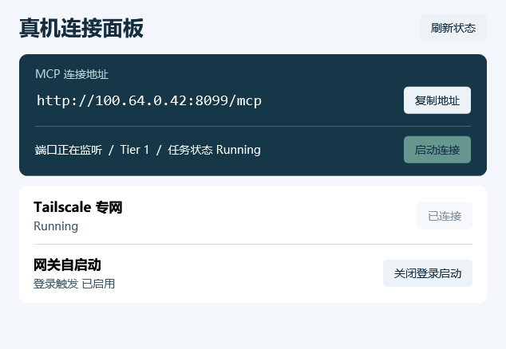

# rig-gateway

[简体中文](README.md) · **English**

Connect Codex or Claude Code to a Windows machine to inspect its status, processes and files over a private network. The **host PC** runs the MCP gateway. The **client PC** runs the AI client.

## One-click setup over Tailscale

Download and extract the [Windows release ZIP](https://github.com/ClimbHillTmr/rig-gateway/releases/latest/download/rig-gateway-windows.zip) on both Windows PCs, or check out the same Git revision. Keep the host folder in its permanent location. First-time setup needs network access and uses WinGet for missing software. Complete any Windows installation prompts and sign in to Tailscale when asked.

| Order | Computer | Double-click in the repository root | Successful result |
|---|---|---|---|
| 1 | Host PC | [Setup-Host.cmd](Setup-Host.cmd) | Shows the verified URL and tier and creates `rig-connection.json` |
| 2 | Client PC | [Setup-Client.cmd](Setup-Client.cmd) | Your selected client, Codex or Claude Code, confirms the connection |

**On the host**, setup prepares Tailscale and Python. For a new deployment, it creates a virtual environment, installs the gateway, registers a current-user login task and starts a **Tier 1 read-only** instance. The default port is `8099`. Setup reuses the address, port and tier of a supported existing task. An occupied port blocks a new deployment. To choose another port, run this from the source root:

```powershell
powershell -NoProfile -ExecutionPolicy Bypass -File deploy/Setup-Windows.ps1 -Role Host -Port 8100
```

**On the client**, place the host’s `rig-connection.json` next to `Setup-Client.cmd` or choose it in the file picker. Setup prepares Tailscale, Python and the selected client CLI. It checks the Windows hostname, full tool inventory and sandbox before registration. Codex discovers tools through a fresh connection. Claude Code checks the effective URL and reports `Connected`. Complete any account sign-in in the client. Share the record privately with the intended operator because it identifies the deployment and its private address.

### Additional devices and accounts

- **Another device you own** can sign in to the same tailnet and run client setup.
- **A teammate** can accept an invitation under Tailscale **Users** using their own account. Grant access to the gateway port.
- **An external collaborator** can accept a single-machine share under **Machines → Share**. Check both tailnets’ access policies. Authorized clients can reuse the same host record. [Inviting vs. sharing](https://tailscale.com/docs/reference/inviting-vs-sharing)

## Host control panel

Double-click [Open-Panel.cmd](deploy/operator-panel/Open-Panel.cmd). The panel shows the listener and a copyable MCP URL above the Tailscale and startup controls. A new deployment supports **start at user login**. An existing boot-task deployment supports **start at boot** and shows the login trigger separately. [Host controls and permissions](docs/operations.en.md#windows-operator-panel)



## Give the setup to an AI

Copy this sentence into an AI that can operate both machines:

```text
Read https://github.com/ClimbHillTmr/rig-gateway/blob/main/docs/ai-setup.en.md and execute the first-time setup prompt to install the host, configure the client and report the read-only verification results.
```

For an existing connection, use the [read-only acceptance prompt](docs/ai-connect.en.md) to check the tools, hostname and sandbox.

## First connection

**A same-machine trial works without Tailscale.** From the source root on Windows with Python 3.10+:

```powershell
python -m venv .venv
.\.venv\Scripts\python.exe -m pip install ".[mcp]"
.\.venv\Scripts\rig-gateway.exe --transport streamable-http --host 127.0.0.1 --port 8099
```

Keep the window open and use `http://127.0.0.1:8099/mcp` in the local client. For stdio, configure the absolute executable path with `--transport stdio`. On a trusted LAN or another VPN, bind the gateway to the reachable private interface and restrict port access. The two setup launchers use Tailscale. [Manual connection and verification](docs/operations.en.md#remote-access)

## Permissions and troubleshooting

| Situation | What to check |
|---|---|
| Local access succeeds but the remote client fails | Check sign-in, invitations or sharing, port access policy and the actual listener. [Troubleshooting by symptom](docs/operations.en.md#troubleshooting) |
| The gateway changed port | Generate a fresh host record. Codex can verify identity and permissions and repair its local URL. Claude Code reports a conflicting URL for inspection. [Codex port repair](docs/reliability.en.md#repair-a-changed-codex-port) |
| The operator needs screenshots, file writes or input | Tier 1 offers 5 read-only tools, Tier 2 offers 12 and Tier 3 offers 15. Command execution and input also require explicit host authorization. Gateway HTTP has no built-in authentication. Limit access using private network policy. [Permissions and sandbox](docs/operations.en.md) |

## Ports and updates

The installed task owns the port. With no task, host setup reuses the port in a matching Tier 1 record before falling back to `8099` for a new installation. An explicit `-Port` applies to a new task. A conflict with an existing task or an occupied port stops setup. A missing higher-tier task requires its original deployment.

If an address works and later reverts, compare the task, the exported record, the effective client entry and any shared configuration manager. After a deliberate port change, run host setup to export a fresh record, update the manager’s named server URL and rerun client setup. Codex supports verified port repair. For Claude Code, update the user entry if it still has the old URL, then check `claude mcp get rig-gateway` for `Connected`.

Download a specific version and `SHA256SUMS.txt` from [Releases](https://github.com/ClimbHillTmr/rig-gateway/releases). Compare `(Get-FileHash .\rig-gateway-windows.zip -Algorithm SHA256).Hash` with the listed digest before extracting. On the client, run the new launcher with the trusted host record. On the host, keep the original directory, task, private record and rollback package. Running setup from a second folder reuses the existing task and verifies its endpoint; the installed service still runs its original package.

To upgrade a one-click Tier 1 service during maintenance, stop its `rig-gateway-user` task, install the new extracted source with the **registered environment’s** `python.exe -m pip install "<new-source-directory>[mcp]"` and run host setup with the retained record. To roll back, repeat using the previous package. Existing boot or higher-tier deployments use their original deployment procedure. For future releases, maintainers set the package version and push the matching `vX.Y.Z` tag. The Windows tests gate publication of the ZIP and checksum. Running the workflow manually on a branch runs verification only.

## Development and license

Run `python -m pytest tests -q` from the repository root. Exercise the Windows panel with `powershell -NoProfile -STA -ExecutionPolicy Bypass -File tests/test_operator_panel.ps1`.

The server uses the Python MCP SDK. Its tools draw on `dddabtc/winremote-mcp`, which credits `CursorTouch/Windows-MCP`. The operating skill and verifier grew out of `ClimbHillTmr/remote-win-mcp`. The verifier supports legacy tool names with `--profile vendor`. [MIT license](LICENSE)
