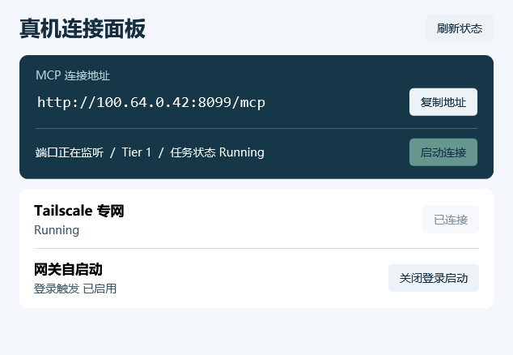

# Windows Rig MCP

**简体中文** · [English](README.en.md)

Windows Rig MCP 是一个自托管的 MCP 服务，让 Codex 和 Claude Code 通过私网连接 Windows 测试设备。默认只读，你可以让 AI 查看真机状态、列出进程、浏览目录和读取文件。需要截图或在指定沙箱内写入文件时，由操作员在目标机启用相应权限。

网关运行在**目标机**，AI 客户端运行在**使用机**。两台电脑可通过 Tailscale 接入，各自双击一个部署入口。安装后的命令和 MCP 连接条目名均为 `rig-gateway`。

## 通过 Tailscale 一键接入

在两台电脑上下载并完整解压[Windows 发布包](https://github.com/ClimbHillTmr/windows-rig-mcp/releases/latest/download/rig-gateway-windows.zip)，或使用同一版本的 Git 检出。请长期保留目标机上的安装目录。首次安装需要网络；缺少依赖时脚本通过 Windows 包管理器 WinGet 安装。按窗口提示完成安装授权和 Tailscale 登录。

| 顺序 | 在哪里操作 | 双击仓库根目录中的文件 | 完成标志 |
|---|---|---|---|
| 1 | 目标机 | [Setup-Host.cmd](Setup-Host.cmd) | 显示已验证的 URL、权限级别，并生成 `rig-connection.json` |
| 2 | 使用机 | [Setup-Client.cmd](Setup-Client.cmd) | 选择 Codex 或 Claude Code，客户端确认已连接到目标机 |

**目标机。** 入口准备 Tailscale 和 Python，首次部署时创建虚拟环境、安装网关、注册当前用户的登录任务并立即启动 **Tier 1，只读**。默认端口为 `8099`。已有受支持的网关任务时，读取其实际地址、端口和权限。端口被其他监听占用时会提示处理。需要指定新部署端口时，从仓库根目录运行：

```powershell
powershell -NoProfile -ExecutionPolicy Bypass -File deploy/Setup-Windows.ps1 -Role Host -Port 8100
```

**使用机。** 将目标机生成的 `rig-connection.json` 私下传给使用者，放在 `Setup-Client.cmd` 旁边，或在文件选择框中选取。入口准备 Tailscale、Python 和所选客户端 CLI。配置前核对 Windows 主机名、完整工具清单和沙箱。Codex 会建立新连接核对工具；Claude Code 会检查实际 URL 和 `Connected` 状态。客户端账号登录按应用提示完成。记录内含私网地址和部署信息，请通过可信渠道传递。

### 多设备与多账号

- **自己的第二台电脑**：登录同一 tailnet，再运行使用机入口。
- **团队成员**：管理员在 Tailscale **Users** 邀请对方自己的账号，允许访问目标机的网关端口。
- **外部协作者**：通过 **Machines → Share** 共享指定目标机，核对双方的访问规则。每台获准的使用机可以复用同一份连接记录。[邀请与设备共享](https://tailscale.com/docs/reference/inviting-vs-sharing)

## 真机操作面板

双击 [Open-Panel.cmd](deploy/operator-panel/Open-Panel.cmd)。顶部显示可复制的 MCP 地址和监听状态，下方显示 Tailscale 和自启动状态。新部署可切换**当前用户登录后启动**。已有开机任务的现场部署可切换**开机启动**，并单独查看登录任务状态。[面板与任务权限](docs/operations.md#真机操作面板)



## 让 AI 帮忙

从零部署时，把下面这句复制给能操作目标机和使用机的 AI：

```text
请读取 https://github.com/ClimbHillTmr/windows-rig-mcp/blob/main/docs/ai-setup.md 并执行其中的从零接入提示词，完成目标机安装、使用机配置和只读连接验证，报告实际结果。
```

仅验收已有连接时，使用[只读验收提示词](docs/ai-connect.md)，检查工具列表、主机名和沙箱。

## 首次连接

**同机试用可以不用 Tailscale。** 在已安装 Python 3.10+ 的 Windows 机器上，从源码根目录运行：

```powershell
python -m venv .venv
.\.venv\Scripts\python.exe -m pip install ".[mcp]"
.\.venv\Scripts\rig-gateway.exe --transport streamable-http --host 127.0.0.1 --port 8099
```

保持窗口打开，客户端使用 `http://127.0.0.1:8099/mcp`。同机客户端也可用可执行文件的绝对路径和 `--transport stdio` 启动网关。跨机走受信局域网或其他 VPN 时，将网关绑定到可达的私网接口，并限制端口访问。双击部署入口专用于 Tailscale。[手动连接与验证](docs/operations.md#远程接入)

## 权限与故障排查

| 症状或需求 | 检查什么 |
|---|---|
| 目标机本地可用，使用机失败 | 两端登录状态、设备邀请或共享、端口访问规则和实际监听地址。[按现象排障](docs/operations.md#故障排查) |
| 端口发生变化 | 在目标机重新生成连接记录。Codex 可以核对身份和权限后更新本地 URL；Claude Code 遇到不同 URL 会提示检查已有条目。[Codex 端口修复](docs/reliability.md#自动修复-codex-端口) |
| 需要写文件、截图或远程输入 | Tier 1 提供 5 个只读工具；Tier 2 共 12 个；Tier 3 共 15 个，执行命令和输入还需服务端显式授权。网关 HTTP 本身无身份认证，应通过私网访问规则限定使用者。[权限与沙箱](docs/operations.md) |

## 端口与版本更新

已有任务时，以任务保存的端口为准。任务缺失时，目标机入口先从本机匹配的 Tier 1 连接记录恢复端口；全新安装才默认使用 `8099`。显式 `-Port` 可用于新建任务。参数与已有任务冲突、端口被占用，或记录中的高权限任务缺失时，安装会停止并提示处理。

遇到“刚修好又变回去”，按顺序核对目标机任务、导出的连接记录、客户端实际条目和共享配置管理器。主动迁移端口后，在目标机重新导出记录，同时更新管理器里对应服务的 URL，再运行使用机入口。Codex 支持核验后自动修复端口。Claude Code 若仍是旧 URL，需要更新用户条目，再用 `claude mcp get rig-gateway` 确认 `Connected`。

从 [Releases](https://github.com/ClimbHillTmr/windows-rig-mcp/releases) 下载指定版本的 ZIP 和 `SHA256SUMS.txt`，用 `(Get-FileHash .\rig-gateway-windows.zip -Algorithm SHA256).Hash` 对照摘要后解压。使用机可直接从新目录启动，选用可信的真机记录。目标机升级前保留原目录、任务、私有记录和回退版本。在第二个目录运行目标机入口会复用并验收已有任务，运行中的服务仍使用原安装包。

升级一键安装的 Tier 1 服务时，在维护窗口停止 `rig-gateway-user` 任务，用**已注册环境中的** `python.exe -m pip install "<新版本解压目录>[mcp]"` 安装，再用保留的记录运行目标机入口。回退时用上一版本包重复该流程。开机任务或高权限现场部署沿用原来的部署流程。维护者更新包版本并推送匹配的 `vX.Y.Z` 标签后，Windows 测试通过才会发布 ZIP 和摘要；在分支上手动运行 Action 可以单独验收。

## 开发与许可

在仓库根目录运行 `python -m pytest tests -q`。Windows 面板测试使用 `powershell -NoProfile -STA -ExecutionPolicy Bypass -File tests/test_operator_panel.ps1`。

服务端使用 Python MCP SDK。工具设计参考 `dddabtc/winremote-mcp` 及其致谢的 `CursorTouch/Windows-MCP`，操作技能与验证器源自 `ClimbHillTmr/remote-win-mcp`。旧工具名可使用 `--profile vendor` 验证。[MIT 许可证](LICENSE)
